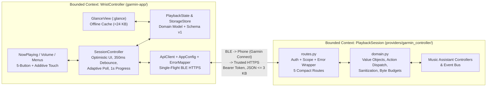

# Garmin Connect IQ Controller for Music Assistant

*   **Author:** Ryan Winkler
*   **Status:** Approved
*   **Date:** 2026-11-19

--------------------------------------------------------------------------------

## Overview

This design defines a two-part remote controller that lets a user wearing a Garmin Fenix 7 (and other Connect IQ 4.0+ watches) control Music Assistant speakers from their wrist, structured with Domain-Driven Design (DDD), DRY, YAGNI, and minimal code footprint:

1.  **Server Bounded Context (`providers/garmin_controller/`):** A zero-dependency Music Assistant Community Catalog plugin exposing 5 authenticated, compact JSON endpoints under `/api/garmin/v1/*`. It models the playback domain cleanly (`domain.py`), enforces strict UTF-8 byte budgets and glyph sanitization for watch fonts, and awaits bounded event convergence (500 ms) so each action returns fresh state in one HTTP round-trip.
2.  **Watch Bounded Context (`garmin-app/`):** A Connect IQ Watch App (`type="watch-app"`, `minApiLevel="4.0.0"`) with an offline-only Glance (`< 24 KB` RAM). It provides Play/Pause, Next, Previous, Repeat cycling (`off`/`all`/`one`), Shuffle, Volume Up/Down/Mute (group-aware), Seek (`+15s`/`-15s`), Stop, Favorite Current Track, Player Switching, Queue jump, Library quick-play (Playlists & Favorites), and Diagnostics—100% operable via the Fenix 7's 5 physical buttons with additive touch zones.

## The Problem

Music Assistant manages multi-room speakers (Sonos, AirPlay, Chromecast, Squeezebox, Snapcast, Sendspin), but controlling playback currently requires a phone or browser. Garmin Audio Content Providers (`SubMusic`, `YuMusic`) sync audio files to watch flash for offline headphones—they cannot control remote speakers, and exporting audio files violates Music Assistant Community Catalog rules. Calling Music Assistant's raw `POST /api` directly from a Garmin watch fails reliably in practice: `players/all` and `player_queues/items` return 15–150+ KB payloads (triggering Connect IQ `-402`/`-403` OOM errors), void commands return JSON `null` (triggering Connect IQ `-400`), and each press costs 2–3 slow BLE round-trips.

Applying YAGNI and DRY, we build **one** compact, watch-safe protocol (`/api/garmin/v1/*`) rather than duplicating a fragile Direct `/api` fallback inside watch RAM.

## Goals

*   Deliver full wrist listening controls on Garmin Fenix 7: Play/Pause, Stop, Next, Previous, Repeat (`off`/`all`/`one`), Shuffle, Volume Up/Down/Mute (group-aware), Seek (`+15s`/`-15s`), Favorite current track, Switch Player/Group, Queue jump, Playlists & Favorites quick-play.
*   Operate 100% via Fenix 7's 5 physical buttons (Touch-OFF safe), with additive touch zones when touch is enabled.
*   Enforce strict root-object JSON and hard UTF-8 byte budgets on every endpoint (`<= 512 B` health, `<= 1024 B` state/action, `<= 3072 B` paginated lists, `<= 384 B` error) with a single DRY paginated list endpoint (`GET /api/garmin/v1/items?kind=queue|playlists|favorites`).
*   Ship an offline-only Glance (`< 24 KB` RAM) reading cached state from `Application.Storage`.
*   Provide built-in Diagnostics & Connection Test mapping exact Connect IQ and HTTP errors to 2-line plain-English fixes.
*   Pass 100% of Music Assistant Community Catalog rules (`providers/garmin_controller/` runtime-only, zero symlinks, zero external wheels, `multi_instance: false`, `pytest`/`ruff`/`mypy`/`codespell`) and Garmin Connect IQ Store publishing requirements.

## Non-Goals

*   Offline watch audio downloading/playback (`audio-content-provider-app`) — prohibited by Music Assistant Community Catalog rules and incompatible with remote speaker control.
*   Direct Native `POST /api` dual-mode fallback — cut per YAGNI/DRY because raw MA responses cause `-400`/`-402`/`-403` failures and double watch transport complexity.
*   Live network polling or `Toybox.Background` 5-minute polling inside the Glance.
*   Plain `http://`, self-signed CAs, or Home Assistant Ingress session URLs on physical watches.
*   Album art bitmaps, free-text search, or queue reordering in v1.

## Open Questions

*   **Local Connect IQ SDK Credentials:** Downloading Garmin's SDK (`monkeyc`) and `fenix7` device profiles requires a Garmin Developer login, which is not configured on this build host. *Resolution:* Provide a single `./garmin-app/scripts/build.sh` script (supporting `.prg` sideload, `.iq` packaging, and ephemeral RSA 4096 dev key generation) plus GitHub Actions CI so compilation runs in one command once SDK credentials are present.

## Critical User Journeys (CUJs)

### CUJ 1: Setup & Connection Check
*   **Given**: Music Assistant 2.x with `garmin_controller` installed and exposed via publicly trusted HTTPS (Let's Encrypt reverse proxy, Tailscale Serve/Funnel, or Cloudflare Tunnel) targeting MA port `8095`; user generated a long-lived Bearer token in Music Assistant (Settings -> Profile).
*   **When**: User enters `serverUrl` and `accessToken` in the **Connect IQ Store** mobile app settings, syncs to Fenix 7, and opens the Watch App (or runs Diagnostics).
*   **Then**: Watch trims whitespace and trailing slashes, validates `https://`, checks `phoneConnected`, verifies `GET /api/garmin/v1/health` (`200`, `api_version: 1`), picks the active playing speaker (or opens the player picker), and renders Now Playing.

### CUJ 2: Wrist Playback Control (Touch-OFF & Touch-ON)
*   **Given**: Now Playing is open for an active Music Assistant speaker.
*   **When**: User presses START/STOP (Play/Pause), DOWN (Next), UP (Previous), holds UP (`onMenu`) -> Volume (UP/DOWN debounced 350 ms -> single `volume_set`; START mutes), Repeat (cycles `off` -> `all` -> `one` in place), Shuffle (toggles in place), Seek (`+15s`/`-15s`), or Favorite Track.
*   **Then**: Watch updates optimistically, sends `POST /api/garmin/v1/action`, plugin awaits `PLAYER_UPDATED`/`QUEUE_UPDATED` up to 500 ms and returns compact state with `settled: true|false`, and watch schedules a single 1.5s refresh only if `settled == false`.

### CUJ 3: Switch Player, Jump in Queue, or Play Playlist / Favorite
*   **Given**: Multiple speakers and library items exist in Music Assistant.
*   **When**: User opens Actions Menu -> Switch Player, Queue, Playlists, or Favorites (all rendered by one DRY paginated `ItemListMenu`).
*   **Then**: Selecting a player persists `selected_player_id` and refreshes state; selecting a queue track sends `play_index`; selecting a playlist/favorite sends `play_media`; view stack pops cleanly back to Now Playing (stack depth `<= 4`).

### CUJ 4: Instant Offline Glance
*   **Given**: User previously opened the Watch App (caching `< 512 B` state in `Application.Storage`).
*   **When**: User scrolls past the Glance on Fenix 7.
*   **Then**: Glance renders player name, play/pause indicator, track/artist, and cache age (`2m ago`) with zero network calls and `< 24 KB` RAM; pressing START launches the Watch App for live sync.

## Technical Plan (Architecture)

### Domain-Driven Bounded Contexts & Data Flow

### Server Wire Protocol (`/api/garmin/v1/*`) — 5 Compact Endpoints

Every response (including lists and errors) is a flat root JSON object (`Content-Type: application/json; charset=utf-8`), never `null`, empty, or a bare array. Every endpoint enforces `await get_authenticated_user(request)`, `has_scope(user, Scope.<REQUIRED>)`, and `set_current_user(user)`.

| Method & Path | Required Scope | Hard UTF-8 Cap | Compact Root Object Schema |
| :--- | :--- | :--- | :--- |
| `GET /api/garmin/v1/health` | `PLAYERS_READ` | `<= 512 B` | `{"ok": true, "api_version": 1, "plugin_version": "0.1.0", "ma_version": "..."}` |
| `GET /api/garmin/v1/players` | `PLAYERS_READ` | `<= 3072 B` | `{"ok": true, "total": N, "offset": 0, "limit": 15, "items": [{"id": str, "n": str(<=24), "s": "playing"\|"paused"\|"idle", "v": int\|null, "m": bool, "g": bool, "q": bool}]}` |
| `GET /api/garmin/v1/state?player_id=...` | `PLAYERS_READ` | `<= 1024 B` | `{"ok": true, "p": {"id": str, "n": str(<=24), "s": "playing"\|"paused"\|"idle", "v": int\|null, "m": bool, "t": str(<=48), "a": str(<=36), "al": str(<=36), "el": int, "du": int, "rp": "off"\|"one"\|"all", "sh": bool, "fav": bool, "nt": str(<=36), "caps": {"vol": bool, "mute": bool, "seek": bool, "q": bool, "rp": bool, "sh": bool, "fav": bool, "grp": bool}}}` |
| `POST /api/garmin/v1/action` | Per action (`PLAYERS_CONTROL` / `QUEUES_CONTROL` / `LIBRARY_WRITE`) | `<= 1024 B` | Body: `{"player_id": str, "action": str, "value": any}`. Actions: `play`, `pause`, `play_pause`, `stop`, `next`, `previous`, `repeat` (`off`\|`all`\|`one`\|`cycle`), `shuffle` (`bool`\|`toggle`), `volume_set` (`0..100`), `volume_up`, `volume_down`, `mute` (`bool`\|`toggle`), `seek` (`{"delta": int}` or `{"position": int}`), `favorite`, `play_index` (`int`), `play_media` (`str` uri). Response: `{"ok": true, "settled": bool, "p": <PlayerSnapshot>}` |
| `GET /api/garmin/v1/items?kind=queue\|playlists\|favorites&player_id=...&limit=10&offset=0` | `QUEUES_READ` (queue) or `LIBRARY_READ` (playlists/favorites) | `<= 3072 B` | `{"ok": true, "kind": str, "total": N, "offset": int, "limit": int, "cur": int\|null, "items": [{"k": str, "t": str(<=40), "sub": str(<=28), "c": bool}]}` (`k` is queue index string or media URI; `c` marks currently playing item) |

*   **Error Envelope (`<= 384 B`):** `{"ok": false, "code": str, "error": str(<=120), "req_id": str}` on all `4xx`/`5xx` responses.
*   **Group Volume Routing:** When `is_group` is true (`player.group_members` non-empty or `PlayerType.GROUP`), volume/mute actions call `cmd_group_volume*` and read `group_volume`/`group_volume_muted` (falling back to individual fields if unset).
*   **Event Convergence:** `POST /action` subscribes to `PLAYER_UPDATED`/`QUEUE_UPDATED` for `player_id` (and its active queue ID) before executing the command, awaits the event up to `settle_timeout_ms` (default 500 ms), unsubscribes in `finally`, and returns `settled: bool`.
*   **UTF-8 Byte Budget Guarantee:** `encode_bounded_json()` validates `len(bytes) <= budget`, trimming trailing list items (and logging a warning) if a worst-case payload would exceed the cap.

### Fenix 7 Input Mapping & View Stack (Depth <= 4)

*   **Now Playing (`NowPlayingView` + `NowPlayingDelegate`)**:
    *   Physical 5-button (100% functional Touch-OFF): `KEY_ENTER` = Play/Pause, `KEY_DOWN` = Next Track, `KEY_UP` = Previous Track, hold `UP` (`onMenu`) = Actions Menu, `KEY_ESC` = Exit.
    *   Additive touch (Touch-ON): `onSelect()` returns `false` while `onKey(KEY_ENTER)` handles physical START/STOP, letting `onTap(clickEvent)` map top strip = Switch Player, center = Play/Pause, left = Previous, right = Next, bottom-left = Volume, bottom-right = Actions Menu.
*   **Dedicated Volume View (`VolumeView` + `VolumeDelegate`)**: `UP`/`DOWN` update optimistic volume and reset a 350 ms debounce timer sending one `volume_set`; `KEY_ENTER` toggles Mute; `BACK` pops to Now Playing.
*   **Actions Menu (`ActionsMenu`)**: Volume, Repeat (cycles in place), Shuffle (`ToggleMenuItem` in place), Seek +15s, Seek -15s, Favorite Track, Switch Player, Queue, Playlists, Favorites, Stop, Refresh, Diagnostics. Items gated on `caps`.
*   **Unified Paginated Picker (`ItemListMenu`)**: One DRY `WatchUi.Menu2` class serving Players, Queue, Playlists, and Favorites with in-place `"Load More"` pagination.

## Alternatives Considered

### Alternative A: Garmin Audio Content Provider (`audio-content-provider-app`) like SubMusic / YuMusic
*   **Pros**: Native Garmin Music widget integration and offline headphone playback.
*   **Cons**: Cannot control remote speakers; downloading/exporting audio files violates Music Assistant Community Catalog rules.
*   **Reason for Rejection**: Rejected by author: violates catalog rules and does not solve remote Music Assistant control.

### Alternative B: Dual-Mode Transport (Plugin + Direct Native `POST /api`)
*   **Pros**: Works partially without installing the MA plugin.
*   **Cons**: Doubles watch transport/parser code (violating DRY/YAGNI), consumes watch RAM, and Direct `/api` breaks on multi-room `players/all` (`-402`/`-403`) and void `null` bodies (`-400`).
*   **Reason for Rejection**: Rejected by author: single compact plugin protocol is smaller, faster, and reliable on all setups.

### Alternative C: Three Separate List Endpoints (`/queue`, `/playlists`, `/favorites`) & Three Watch Menu Classes
*   **Pros**: Slightly more specific field names per list type.
*   **Cons**: Triplicates pagination, byte-budgeting, error handling, and Monkey C `Menu2` view/delegate boilerplate.
*   **Reason for Rejection**: Rejected by author: one unified `GET /api/garmin/v1/items?kind=...` endpoint and one `ItemListMenu` class keep both server and watch DRY.

### Alternative D: Live Network Fetching or `Toybox.Background` Polling in Glance
*   **Pros**: Potentially fresher Glance without opening the app.
*   **Cons**: Exceeds Fenix 7's 28–32 KB Glance RAM budget, stalls Glance scrolling over BLE, and 5-minute background polling drains battery while still showing stale tracks.
*   **Reason for Rejection**: Rejected by author: offline cached Glance is instantaneous, safe, and zero-battery overhead.

--------------------------------------------------------------------------------

## Non-Functional Requirements

*   **Security & Privacy**: All 5 routes require Music Assistant Bearer auth + exact `Scope` check (`get_authenticated_user`, `has_scope`, `set_current_user`). Tokens never appear in query strings, logs, or Diagnostics UI.
*   **Performance & Latency**: Single-flight BLE coordinator, monotonic sequence counter preventing stale poll overwrites, 350 ms volume/seek debounce, adaptive polling (10s playing, 30s paused, 0s hidden), 1s local elapsed-time interpolation, hard UTF-8 byte caps on every endpoint, `< 24 KB` Glance RAM.
*   **Migration & Rollback**: `/api/garmin/v1/` additive-only contract with `api_version: 1` handshake; watch `Application.Storage` guarded by `storage_schema_version = 1`; plugin `unload()` cleanly unregisters all routes with zero side-tables; independent release tags `provider-vMAJOR.MINOR.PATCH` (`tag_prefix: "provider-"`) and `watch-vMAJOR.MINOR.PATCH`.

--------------------------------------------------------------------------------

## Detailed Implementation Plan

### Target Files to Create

#### 1. Music Assistant Plugin (`providers/garmin_controller/` — runtime only, zero symlinks, zero tests)
1.  **`providers/garmin_controller/manifest.json`** — Plugin manifest (`type: "plugin"`, `domain: "garmin_controller"`, `multi_instance: false`, `requirements: []`).
2.  **`providers/garmin_controller/icon.svg`** — Minimal vector watch+waveform icon (`<= 5 KB`, drawing primitives only).
3.  **`providers/garmin_controller/strings.json`** — English labels for `settle_timeout_ms` config entry.
4.  **`providers/garmin_controller/domain.py`** — DDD domain layer: `API_VERSION`, byte budgets, `ActionName` & scope map, `sanitize_text()`, `build_player_summary()`, `build_player_snapshot()`, `build_items_page()`, `encode_bounded_json()`. Pure logic with zero HTTP/framework dependencies.
5.  **`providers/garmin_controller/routes.py`** — Thin `aiohttp` transport adapter: shared auth/scope/error/logging wrapper and the 5 route handlers (`/health`, `/players`, `/state`, `/action` with 500 ms event convergence, `/items`).
6.  **`providers/garmin_controller/__init__.py`** — `GarminControllerPlugin(PluginProvider)`: `setup()`, `get_config_entries()`, transactional route registration in `loaded_in_mass()`, symmetric cleanup in `unload()`.

#### 2. Protocol Spec, Tooling & Automated Tests
7.  **`docs/protocol/v1.md`** — Canonical v1 wire protocol specification & error code table.
8.  **`docs/protocol/v1_schemas.json`** — JSON Schema definitions for all 5 endpoints + error envelope.
9.  **`pyproject.toml`** — Root Python config (`pytest`, `pytest-aiohttp`, `ruff`, `mypy`, `codespell`, `jsonschema`).
10. **`tests/conftest.py`** — Mock Music Assistant server + real `aiohttp.web.Application` dynamic-route harness.
11. **`tests/provider/test_plugin_lifecycle.py`** — Manifest, icon (`<= 5 KB`), zero-symlink check, load -> 200 -> unload -> 404 -> reload -> 200, partial-registration rollback.
12. **`tests/provider/test_api_endpoints.py`** — Auth 401/403, all 5 routes, every action (`play`, `pause`, `play_pause`, `stop`, `next`, `previous`, `repeat`, `shuffle`, `volume_set/up/down`, `mute`, `seek`, `favorite`, `play_index`, `play_media`), group volume, non-queue sources, event settlement (`settled: true/false`), malformed/empty POST bodies.
13. **`tests/contract/test_protocol_contract.py`** — Validates all endpoint responses against `docs/protocol/v1_schemas.json`, asserts root JSON object invariants, and verifies UTF-8 byte caps on worst-case payloads (50 players, 200-char emoji/Unicode strings, null metadata).

#### 3. Garmin Connect IQ Watch App (`garmin-app/`)
14. **`garmin-app/manifest.xml`** — `type="watch-app"`, `minApiLevel="4.0.0"`, `Communications` permission, Fenix 7 + modern Connect IQ 4.0+ device matrix.
15. **`garmin-app/monkey.jungle`** — Scopes build strictly to `source/` and `resources/`.
16. **`garmin-app/resources/strings/strings.xml`** — UI labels, settings copy (referencing Connect IQ Store app), and error messages.
17. **`garmin-app/resources/settings/properties.xml`** & **`settings.xml`** — Settings (`serverUrl`, `accessToken` with `maxLength="512"`, `pollIntervalSec`, `seekStepSec`, `volumeStep`, `vibrateFeedback`).
18. **`garmin-app/resources/drawables/drawables.xml`** & **`launcher_icon.png`** — 40x40 high-contrast launcher icon.
19. **`garmin-app/source/MusicAssistantApp.mc`** — `(:glance)` `Application.AppBase` entry.
20. **`garmin-app/source/PlaybackState.mc`** — `(:glance)` `StorageStore` (schema v1) + `PlaybackState` / `ListItem` domain models, defensive JSON parsing, optimistic transitions, local elapsed interpolation.
21. **`garmin-app/source/GlanceView.mc`** — `(:glance)` Offline-only Glance view (`< 24 KB` RAM).
22. **`garmin-app/source/ApiClient.mc`** — `AppConfig` (safe `Properties` normalization), `ErrorMapper` + 8-entry diagnostics ring buffer, single-flight `ApiClient` (`phoneConnected` check, monotonic `reqSeq`, `X-Garmin-Req-Id`, `{}` POST body).
23. **`garmin-app/source/SessionController.mc`** — Coordinates state, adaptive polling, 1s progress ticker, 350 ms volume/seek debounce, settle follow-up poll, and haptic feedback.
24. **`garmin-app/source/NowPlayingView.mc`** — Proportional 64-color MIP Now Playing view + hybrid 5-button / additive touch `BehaviorDelegate`.
25. **`garmin-app/source/VolumeView.mc`** — Dedicated radial volume view + debounced `BehaviorDelegate`.
26. **`garmin-app/source/Menus.mc`** — `ActionsMenu`, DRY paginated `ItemListMenu` (Players / Queue / Playlists / Favorites), and `DiagnosticsView` (staged connection test + error log).
27. **`garmin-app/source/tests/UnitTests.mc`** — Run No Evil `(:test)` tests for URL normalization, error mapping, JSON parsing, storage migration, and volume clamping.
28. **`garmin-app/scripts/build.sh`** — Single DRY CLI script building `.prg` (sideload), `.iq` (`--package`), and generating ephemeral RSA 4096 DER dev keys when needed.
29. **`garmin-app/store/listing.md`** — Connect IQ Store description, permission disclosures, and screenshot spec (excluded from `monkey.jungle`).

#### 4. CI/CD & Documentation
30. **`.github/workflows/provider.yml`** — Path-scoped provider checks (`pytest`, `ruff`, `mypy`, `codespell`, symlink/contract checks, upstream `check-provider.yml@main` + weekly cron + `provider-v*` release).
31. **`.github/workflows/garmin.yml`** — Path-scoped Garmin build & `watch-v*` `.iq` release workflow.
32. **`docs/user/music-assistant-setup.md`**, **`docs/user/garmin-setup.md`**, **`README.md`**, **`.gitignore`**, **`LICENSE`**.

### Verification Plan

*   `uv run pytest -v` (all lifecycle, API, error, convergence, contract, byte-budget, and symlink tests green).
*   `uv run ruff check .` & `uv run ruff format --check .` (zero warnings/errors).
*   `uv run mypy .` (strict mode clean).
*   `uv run codespell` (zero typos).
*   `./garmin-app/scripts/build.sh fenix7` + Run No Evil `(:test)` + Simulator Memory Viewer (`< 24 KB` Glance RAM, *"Use Device HTTPS Requirements"* enabled) once Connect IQ SDK credentials are configured.

--------------------------------------------------------------------------------

*Drafted with EGM*
